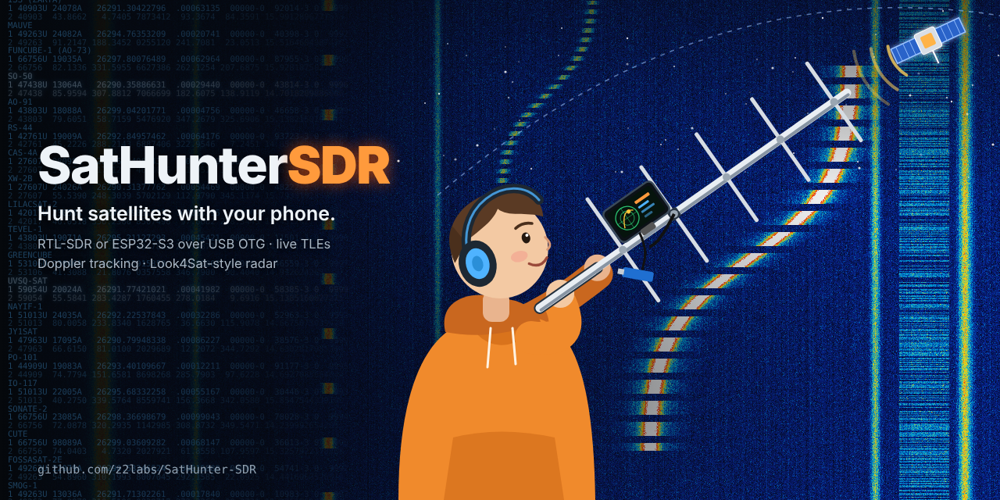

# SatHunterSDR



A satellite-hunting SDR receiver for Android: pick a satellite, the app tunes to it and follows
its Doppler shift, and a Look4Sat-style radar turns with your phone so you can point the antenna.
Made for classrooms first: it runs without hardware (a simulated RTL-SDR with a simulated pass),
and decoders are small plugins that students can write.

## Features (0.2 beta)

- **Satellites**: SatNOGS DB and CelesTrak data, pass prediction (SGP4, checked against Skyfield), filters by band, mode, status; favourites first, "Next pass" or "Best heard" (SatNOGS reception) order.
- **Doppler tracking**: tunes to the selected downlink and follows it. Your own retuning is kept as an offset (linear transponders).
- **Radar**: the whole pass with AOS/LOS times, the satellite, others overhead. A compass mode follows the phone; aim mode guides you to the satellite.
- **Receiver**: GPU spectrum and waterfall, NFM / WFM / AM / USB / LSB / CW, pinch zoom, drag to tune, full-screen mode with floating controls that fade away.
- **SDRs**: RTL-SDR and ESP32-S3 (ESP-SDR firmware, 2204–2804 MHz, smooth in-stream tuning), plug and play over USB OTG.
- **Demo source**: FM broadcast, airband, APRS, a CW beacon, ISM bursts and the selected satellite at its real Doppler frequency, with "Simulate this pass now".

Coming next: decoder plugins (AX.25 / APRS first), the ESP-SDR wideband spectrum mode and firmware updater, rtl_tcp, more sources.

## Layout

```
core/       Rust: sh-sat, sh-dsp, sh-sources, sh-plugin, sh-engine, sh-android (JNI)
android/    Kotlin + Jetpack Compose app
catalog/    satellite profiles (index.json)
plugins/    decoder plugins (Luau), one folder each
docs/       PLUGINS.md, Z2-SDR-DESKTOP-REWRITE.md
```

## Build

```
cd core && cargo test --release --workspace
cargo install cargo-ndk
cd core && cargo ndk -t arm64-v8a -t armeabi-v7a -t x86_64 -P 26 -o ../android/app/src/main/jniLibs build --release -p sh-android
cd android && ./gradlew assembleRelease
```

CI builds the APK on every push; it is under Actions → Build → artifacts. Tags `v*` make a release.

## License

GPL-3.0-or-later. Satellite data: SatNOGS DB (CC BY-SA 4.0), CelesTrak.
SGP4 by the `sgp4` crate (MIT), FFT by `rustfft` (MIT / Apache-2.0).
